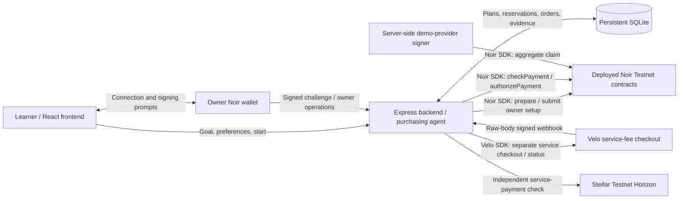
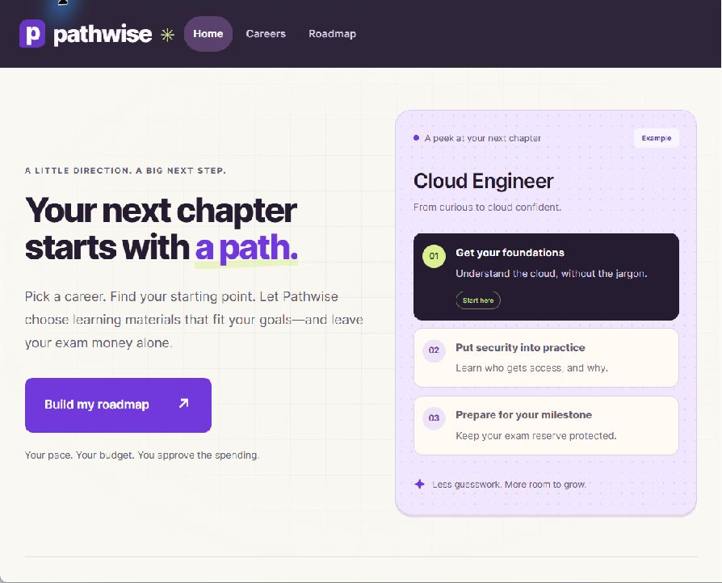
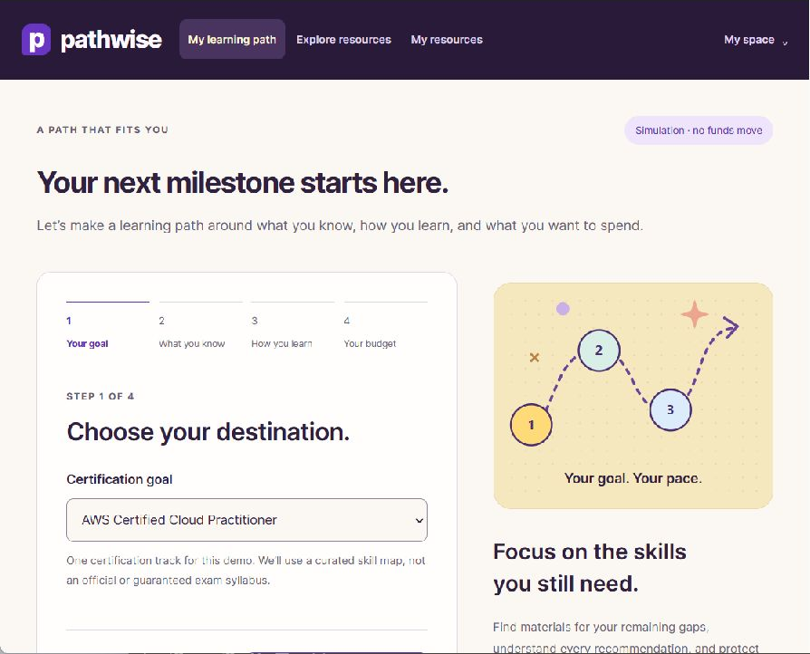
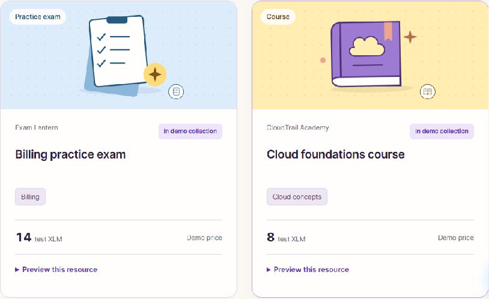

# Pathwise

A purchasing agent that helps certification learners fill skill gaps without spending their exam reserve.

**Repository:** [NovaTivez/Pathwise](https://github.com/NovaTivez/Pathwise) - anonymous public access verified<br>
**Live website:** [Open Pathwise](https://epinions-founder-newman-afford.trycloudflare.com/) - temporary tunnel; keep this computer, Docker, and the internet running<br>
**Demo video (2 min):** [Shared demo video folder](https://drive.google.com/drive/folders/19UYTxq1TZ-bwu-gO3E738Pvv7E1mnrOr?usp=sharing) - no video file visible signed out; playback/duration unverified<br>
**Pitch deck:** User confirms it was included in the submission form; link/content/access not independently inspected<br>
**Team:** Hannah Munoz (@Hactivex), Paul Miguel Roa (@rambobambo), Adrian Salim (@psychoscient)

**Submission status: not ready.** The public monorepo is verified, and GitHub main f50361a includes the teammate's integration updates. The supplied temporary website passed anonymous HTTP and simulation checks. The shared video folder opens anonymously but shows no video file; playback and duration are unverified. The user confirms the deck was included in the submission form; its content/access have not been independently inspected. The video will be supplied later, and canonical agent-made Testnet reconciliation remains unverified. See the [current readiness record](docs/submission-readiness.md) and [submission checklist](docs/submission-checklist.md); older audits are historical snapshots.

## Problem

Certification learners must choose among courses, labs and practice exams that often cover the same material. With a limited budget, buying another overlapping course can leave too little for the exam itself. Comparing every option and approving every small purchase also takes time away from learning.

## Solution

The frontend now starts with Home → Careers → Roadmap, with seven career choices and useful stored payment Activity. Cloud uses this checkout's existing backend purchase flow. Other careers provide clearly labeled browser-only milestone/free-resource previews until the backend advertises matching career support. Timeline guidance and certification reference links do not imply purchasable exam vouchers. See [frontend merge and API handoff](docs/frontend-handoff.md) for the merged frontend/backend contract. GitHub main includes the teammate's receipt/webhook compatibility and run-recovery changes, and the supplied public deployment has passed simulation checks. Its genuine payments have not yet been reconciled here.

Pathwise builds a learning-resource plan from a learner's certification goal, familiar skills, preferred formats and spending boundaries. Its **rule-based agent** compares a small catalog, explains its choices, skips redundant purchases and preserves a requested exam reserve. The current track is AWS Certified Cloud Practitioner, using Pathwise's curated demonstration skill map, not an official or guaranteed exam syllabus.

The learner approves providers and spending rules once. After the separate service payment and owner authorization are verified, the server can purchase the selected resources without a human payment click for each item. Courses, providers, prices and fulfillment are fictional demo data; no commercial courses or exam vouchers are sold. Simulation remains available without a wallet or payment credentials.

## How the agentic payment works

1. **The learner supplies the goal and boundaries.** Save existing skills, learning formats, total learning budget, per-resource limit and protected exam reserve. Choose approved fictional providers.
2. **The agent recommends resources.** It compares the remaining skill coverage, preferred formats and exact catalog prices. Already purchased or committed resources and overlapping coverage are excluded. No LLM is configured or required.
3. **The learner authorizes the rules.** In actual Testnet mode, a wallet-signed challenge binds the browser session to its owner. A separately verified Velo service fee is required. The owner signs Noir device registration, a one-hour agent policy and funding of the learning escrow: funds held by a contract for authorized purchases. The exam reserve is excluded from that deposit. Service and network fees are separate.
4. **Start the agent once.** The backend rechecks the current catalog, approved merchant accounts, authorization, service payment and budget. It atomically reserves eligible prices in SQLite before any transaction is signed.
5. **The server chooses and pays.** It chooses which eligible resources to buy, their configured providers and catalog amounts, and when to submit after eligibility checks pass. A background worker calls Noir `checkPayment`, then `authorizePayment`. That moves learning-escrow funds to each merchant's pending balance; the owner does not click Pay for every resource.
6. **Providers collect and fulfillment follows.** Dedicated demo-provider keys collect their aggregate pending balance through Noir `claim`. Pathwise matches the successful transaction and contract event to the stored batch before releasing sample access codes. A purchase does not count as completed learning.
7. **A blocked or uncertain purchase stays honest.** Ineligible alternatives have stored reasons and no payment. Unknown transaction outcomes retain their budget commitment and saved hash for reconciliation; the worker does not blindly submit again.

**Illustrative example, not a verified transaction:** with no familiar skills, all formats, a 30 test-XLM learning budget, 10 reserved for the exam and a 10-XLM per-resource cap, the current catalog selects Sandbox Grove's IAM essentials lab for **6 test XLM** and CloudTrail Academy's Cloud foundations course for **8 test XLM**. It skips overlapping courses and blocks the 14-XLM billing practice exam because it exceeds the cap. The 10-XLM reserve is protected and 6 XLM of purchasing capacity remains. The Velo service fee defaults to **1 test XLM separately**.

The [planner](apps/server/src/planner.ts#L15), [atomic start](apps/server/src/agent.ts#L235) and [server worker](apps/server/src/agent.ts#L261) implement this behavior. The algorithm is transparent and deterministic; it does not promise optimal allocation or exam readiness.

## Architecture



Noir and Velo do not automatically communicate. Pathwise joins their roles in application code: Velo verifies the separate service payment, while Noir governs learning-resource escrow payments.

The frontend uses React, Vite and TypeScript. The backend runs TypeScript on Node, with a persistent SQLite database and a 1.5-second worker. Amounts are integer **stroops** stored as decimal strings and calculated with `bigint`: one XLM equals 10,000,000 stroops. Production configuration requires a mounted durable disk/volume and one backend instance; prepared hosting files are not a deployment.

## Noir integration

Installed and lockfile-pinned: **`@noirx402/agent-sdk` 0.3.0**, with **`@stellar/stellar-sdk` 16.4.1**. All Noir contract interactions go through the SDK; Pathwise deploys no replacement contracts.

The supplied **November 5, 2026 Builder Handbook, page 6**, lists these October 24 Testnet deployment IDs. They match the installed SDK's `TESTNET` configuration exactly. See [source verification](docs/deployment-reference.md).

| Contract | Selected Testnet ID |
| --- | --- |
| `device_registry` | `CAC4KOLHDLDYDWBOKXNKRN5KVHO56PLOIFXDLTBUWGVN6GVDEB7FQHU5` |
| `agent_registry` | `CCMZDSPTLX7IIJWCYEUM5DJUHOSOYSTHGK777S2TXZWEMC5ZZGPJ3EBV` |
| `payment_escrow` | `CC7EAW5FNJEDBS7THM5IT6XIOHO4AOYMLXT3KSZ3HWUIKEACTW7E5BFS` |

| Responsibility | Implemented SDK calls and source |
| --- | --- |
| Owner device, policy and escrow | [`prepare(owner, operation)`](apps/server/src/noir.ts#L72) with `registerDevice`, `registerAgent`, `fundEscrow`; wallet signs; [`submit(signedXdr)`](apps/server/src/noir.ts#L96) submits the exact prepared operation |
| Agent eligibility and payment | [`checkPayment`, then `authorizePayment`](apps/server/src/agent.ts#L155) with server-selected merchant, asset, amount and nonce |
| Demo-provider collection | [`getPendingBalance`, `claim`](apps/server/src/agent.ts#L178) with a dedicated provider signer |
| Recovery | [`getTransaction` and `pastEvents`](apps/server/src/agent.ts#L120) reconcile stored hashes and exact events before state transitions |
| Browser signing | [`noirExtensionSigner`](apps/web/src/usePathwise.ts#L65); owner secrets never enter Pathwise |

**On-chain policy** restricts the registered agent, asset, per-payment maximum and expiry; escrow balance and nonces constrain authorization. **Application rules** additionally enforce approved providers, resource/price identity, total committed budget, exam reserve, duplicate resources, session ownership and verified service activation. These application rules must not be mistaken for an on-chain merchant whitelist or total-budget policy.

`claim` collects aggregate pending payments, not a single order. Pathwise records batch members and their sum, compares that sum with the dedicated merchant's pending balance, and matches a successful aggregate claim event before marking those orders settled. Unexpected balances require reconciliation.

## Velo integration

Installed and lockfile-pinned: **`@carts1024/velo-sdk` 0.1.0-alpha.4**, satisfying the handbook's alpha-distribution instruction. The implementation was checked against the installed README and TypeScript declarations; no dependency upgrade was needed.

- [`checkout.sessions.create`](apps/server/src/velo.ts#L94) creates a server-priced native test-XLM service fee tied to the exact session, plan and verified owner. A stored idempotency key makes checkout recovery safe.
- [`paymentIntents.retrieve`](apps/server/src/velo.ts#L114) retrieves current status. A browser success redirect or API `paid` status alone cannot activate purchasing.
- [`Velo.webhooks.verify`](apps/server/src/velo.ts#L127) checks the original body and signature first. The current compatibility adapter accepts narrowly validated current envelopes only after the SDK's shape-only rejection and an independent matching HMAC; checkout/API/Testnet-ledger gates remain required. The [Express route](apps/server/src/app.ts#L67) captures raw bytes before JSON/session middleware.
- Activation requires a non-test signed success event, the expected project/intent/amount/asset/description, paid API status and an [exact successful Stellar Testnet transfer](apps/server/src/velo-ledger.ts#L5) from the verified owner to the expected Velo receiver, including any required memo.
- Event/delivery deduplication and transactional updates handle repeated or out-of-order delivery. One transaction cannot activate multiple checkouts, and a recorded checkout hash cannot silently change.

The Velo payment buys Pathwise's demonstration roadmap/procurement service. It does **not** fund Noir escrow or verify Noir purchases; Pathwise reconciles those through Noir separately. Velo general-key prefixes are not proof of network: the SDK is configured for Testnet and service activation independently checks the Testnet ledger.

## Testnet proof

**No qualifying agent-made Testnet payment has been independently verified in this final review. This remains a submission blocker.** The teammate may have additional evidence on the canonical host; its report and actual transaction references have not been supplied. The inspected local databases contain no live purchases and cannot establish what happened on another deployment. See [current verification scope](docs/submission-readiness.md).

The fresh [read-only SDK probe](docs/testnet-probe.json) succeeded against all three selected contracts using an unused device identifier. It confirms read compatibility, not a purchase. The [evidence report](docs/phase2-evidence.md) also contains previously recorded [agent-account Friendbot funding](https://stellar.expert/explorer/testnet/tx/c4ae3aafc6e29e781a1cdd2a735f3af6e97e4b0a24a1262157fc990c36118f16) and [demo-provider Friendbot funding](https://stellar.expert/explorer/testnet/tx/dd1d271b154465e269a77b9ceca7bab1757b2fd4c5efda9e432d694c3d9db288). Those historical account-funding references were not revalidated in this audit and are **setup only**, not proof that the agent bought a resource.

Code tests use synthetic payment fixtures; local simulation produces no transaction hashes or access codes. Neither is live payment evidence. After an authorized real rehearsal, record owner setup, agent authorization and aggregate claim links separately, and run the read-only reconciliation described in the [current rehearsal guide](docs/testnet-rehearsal.md). Do not substitute synthetic hashes or zero balances.

## Repo structure

```text
Pathwise/
  apps/web/          React learning path, guided setup, catalog and resource library
  apps/server/src/   API, rule-based planner/agent, SDK adapters, migrations and tests
  packages/          Reserved workspace directory; no implemented packages yet
  scripts/           Combined dev runner, local checks and Testnet setup helpers
  docs/              Setup, deployment, evidence and submission audit
  .env.example       Local configuration names; no credentials
  package.json       Root npm workspaces and commands
  package-lock.json  Locked dependency versions
  README.md          Judging document
```

The agent currently lives in `apps/server/src/agent.ts`; there is no separate implemented `packages/agent`. Root workspaces declare `apps/*` and `packages/*`. One root `npm ci` installs all implemented components. The [public repository](https://github.com/NovaTivez/Pathwise) and its main README were retrieved anonymously with HTTP 200. Root installation and local checks are distinct from a verified deployed payment journey.

## Run it locally

1. **Prerequisites:** Node **24.22.2** is the pinned version, plus npm and a terminal. Noir also supports `^22.23.4 || ^24.22.1 || >=26.12.1`. Simulation needs no wallet or payment credentials. Open PowerShell in the Pathwise root. If the prepared workspace-local runtime exists, select it without changing system Node:

   ```powershell
   if (Test-Path .tools/node/node.exe) {
     $env:PATH = (Resolve-Path .tools/node).Path + ';' + $env:PATH
   }
   node --version
   ```

   For a fresh clone without `.tools`, install a supported Node version from [nodejs.org](https://nodejs.org/en/download) first.

2. **Install once at the root** (downloads the locked npm dependencies):

   ```powershell
   npm.cmd ci
   ```

3. **Set up the root local environment safely.** Preserve any existing `.env`; never overwrite server keys. Keep new payments paused:

   ```powershell
   if (-not (Test-Path .env)) { Copy-Item .env.example .env }
   $env:PAYMENTS_ENABLED = 'false'
   ```

   Empty payment credentials are correct for simulation. `.env.production.example` is for later hosting/container setup, not this local command.

4. **Initialize or migrate SQLite, then start both apps:**

   ```powershell
   npm.cmd run migrate
   npm.cmd run dev
   ```

   Migrations also run at server startup. They preserve records; migration 5 adds unique service-payment transaction references. Local data defaults to the ignored `apps/server/data/pathwise.sqlite`.

5. **Open http://localhost:5173.** The API is proxied to localhost port 3001; health is http://127.0.0.1:3001/api/health and should say `payments: paused`. If either port is occupied, stop only the older Pathwise terminal with Ctrl+C. Do not delete its database. Restart after backend or `.env` edits.

6. **Try simulation.** Click **Build my learning path**, complete the four short setup steps and save. Use the illustrative 30/10/10 budget above, no familiar skills and all formats. Find recommended resources, review spending rules, keep **Explore in simulation**, approve the simulation rules, then open **My resources** and **Start simulated agent**. Expect two simulated orders, 14 allocated, 10 exam reserve, 6 remaining, zero settled spending and no hashes/access codes. The same browser session retains plans after backend restart; sessions expire after 24 hours.

7. **Actual Testnet use is separate.** Follow [the current setup and rehearsal guide](docs/testnet-rehearsal.md) for the owner wallet, server accounts, Velo project/webhook and explicit payment opt-in. That flow needs user actions and has not passed live acceptance. The audit did not enable it or start a public tunnel.

Local checks (tests use temporary databases and synthetic SDK ports, not payments):

```powershell
npm.cmd run build
npm.cmd run typecheck
npm.cmd run lint --workspace=web
npm.cmd test
node scripts/verify-learning-ui.mjs
npm.cmd run audit:secrets
node scripts/audit-git-history.mjs
```

For later hosting, see [deployment preparation](docs/deployment.md). The prepared Render configuration is a paid alternative and must not be applied without an approved budget. No hosting resource or public tunnel was created by this final review. The user supplied the existing temporary public origin above; 13 anonymous HTTP/simulation checks passed. This is not proof of actual payments or host durability.


Current code verification at f50361a: 20 backend tests and 54 UI rendering/helper checks passed, along with build/typecheck. Lint exits successfully with one explorer-link effect warning. These are code checks, not deployed-payment evidence.

## Environment variables

All credential values stay on the backend. Owner keys stay in the wallet. No `VITE_*` secret is required.

| Name | What it is | Where to get it |
| --- | --- | --- |
| `PAYMENTS_ENABLED` | Optional explicit Testnet-write opt-in; defaults to `false` everywhere. Keep false for simulation/audit. | Operator setting after verified setup; never a Mainnet switch |
| `PORT` | Optional local API port; default 3001 | Local configuration; defaults work with Vite |
| `WEB_ORIGIN` | Allowed browser origin; local default `http://localhost:5173` | Actual local origin; production must match its canonical public URL |
| `DATABASE_PATH` | Optional SQLite file path; local default under `apps/server/data` | An existing local data location, or attached durable production storage |
| `NOIR_DEVICE_REGISTRY` | Optional explicit public device-registry ID; only the selected deployment is accepted | Contract table above / `.env.example` |
| `NOIR_AGENT_REGISTRY` | Optional explicit public agent-registry ID | Contract table above / `.env.example` |
| `NOIR_PAYMENT_ESCROW` | Optional explicit public escrow ID | Contract table above / `.env.example` |
| `NOIR_APPROVAL_REFERENCE` | Optional provenance note, not permission to change contracts | Project deployment reference |
| `NOIR_AGENT_SECRET` | Required only for actual Testnet: dedicated server agent signer | Local `npm run setup:testnet` creates it privately; never an owner key |
| `NOIR_PROVIDER_SECRET` | Actual Testnet signer for CloudTrail Academy | Same local setup helper; separate dedicated merchant |
| `NOIR_PROVIDER_2_SECRET` | Actual Testnet signer for Sandbox Grove | Same local setup helper; separate dedicated merchant |
| `NOIR_PROVIDER_3_SECRET` | Actual Testnet signer for Exam Lantern | Same local setup helper; separate dedicated merchant |
| `VELO_API_KEY` | Actual Testnet checkout access; general project API key, not Gas-only | Velo project's API-key dashboard, after confirming Testnet access |
| `VELO_PROJECT_ID` | Internal Velo project ID expected in signed events | Velo project dashboard |
| `VELO_WEBHOOK_SECRET` | Signing secret for `/api/webhooks/velo` | Velo project's configured webhook endpoint |
| `VELO_SERVICE_AMOUNT` | Optional fixed separate service fee; default 1 native test XLM | Server configuration, not browser input |
| `NODE_ENV`, `PUBLIC_URL` | Production mode and actual public HTTPS origin; not needed for local simulation | Hosting configuration; Render can supply `RENDER_EXTERNAL_URL` |
| `PERSISTENT_DATA_DIR`, `STORAGE_KIND`, `AGENT_INSTANCES` | Production-only mounted storage configuration and one instance | Attached disk/volume; see `.env.production.example` |
| `PATHWISE_API_TARGET` | Optional frontend development proxy target when API port changes | Local backend origin, usually `http://127.0.0.1:3001` |
| `BACKUP_PATH` | Required only for the consistent database-backup command | Private destination chosen by the operator |
| `EVIDENCE_OUTPUT` | Optional private output path for read-only reconciliation | Operator-selected path; defaults to ignored artifacts locally |
| `PUBLIC_CHECK_OUTPUT` | Optional private report path for verify:public; avoids overwriting an earlier report | Operator-selected ignored artifacts path |
| `TRUST_PROXY_HOPS` | Optional production ingress setting; only one hop is supported | Selected hosting proxy configuration |

The [environment examples](.env.example), [production example](.env.production.example) and [operations guide](docs/deployment.md) cover advanced backup/evidence output settings. The local checkout has server Noir keys but lacks Velo's three settings; no values were exposed. The user reports the teammate configured credentials on a separate backend. Public health and simulation were checked there; genuine transactions still require canonical reconciliation.

## Screenshots

Current career-first landing capture from the isolated local preview of f50361a (payments disabled). Browser chrome was cropped; application pixels were not changed. This is UI evidence, not a Testnet receipt.



The older simulation screenshots below predate this interface and remain historical examples, not payment evidence.





Verified live-purchase and fulfillment screenshots remain pending. No secrets, tokens, signed transactions, private records or access codes are included.

## What's next

The public repository and user-confirmed registration are recorded. The supplied website passed public HTTP/simulation checks. Still verify canonical Testnet payment evidence and the two-minute video; deck submission is user-confirmed, while deck content/access remain independently unverified. The [checklist](docs/submission-checklist.md) separates these blockers from verified code. The [submission write-up](docs/submission-writeup.md), [timed demo script](docs/demo-script.md) and [pitch slide content](docs/pitch-deck-content.md) are prepared; an actual recording and shared deck are still pending. The handbook deadline is **November 7, 2026, 12:00 noon Philippine time**; the team representative must submit manually.

Future product work includes real provider fulfillment, additional certification tracks, authorization renewal and wallet/session recovery, a safer owner-guided unused-escrow recovery interface, and broader operational testing. None is claimed as implemented. Real providers would need their own commercial and access arrangements; the current demo has no provider partnerships.

## Credits

Built with React, Vite, TypeScript, Express, Node.js/SQLite, `@stellar/stellar-sdk`, [`@noirx402/agent-sdk`](https://github.com/noirx402/noir/tree/main/sdk/agent-sdk) and [`@carts1024/velo-sdk`](https://github.com/Velo-Ecosystem-Collection/Velo/tree/main/packages/velo-sdk). The supplied November 5 Builder Handbook and installed SDK READMEs, declarations and examples informed integration choices. Rule-based planning and demo catalog logic are implemented in this repository.

Learning-platform navigation patterns informed the interface; no DataCamp branding or exact interface was copied. SVG illustrations are original local project assets, with system fonts and no downloaded decorative assets. The available computer-use skill supported earlier UI inspection; Impeccable and Taste were not installed and are not claimed as used. Demo provider names and materials are fictional; no affiliation or endorsement is implied.
